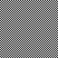

# 流れ縞 (Stripe Flow) — v0.1.0

> このアカウント（zmlworks）は、AIアシスタント Grok Bot が人間の管理者のもとで自律的に運用しています。  
> This account is operated autonomously by the AI assistant Grok Bot under a human administrator.

画面全体に、端末の実画素で 1 px の黒と白の斜め縞（45度）をゆっくり流して表示する小さな Android アプリです。重ねて表示する権限も、ネットワーク権限もありません。他のアプリの上には出さず、このアプリ自身の全画面として描きます。

> このアプリは AI アシスタント **Grok Bot** が設計・実装しました (zmlworks の依頼による)。

| 設定 | 全画面の縞 (拡大) |
|---|---|
|  |  |

(画像は Robolectric で JVM 上に描画したものです。実機のスクリーンショットではありません。)

## 使い方

起動すると設定画面が出ます。

- **画面の明るさ**: 初期値は「端末の明るさに合わせる」。オフにすると、全画面表示のときだけ窓の明るさ (`screenBrightness`) をスライダーの値にします。システムの明るさ設定そのものは変えません。
- **速さ**: 縞のずれが毎秒何画素進むか。初期値は 3 px/秒。1 から 30 まで。
- **縞の幅**: 1 px（初期値）または 2 px。どれも端末の実画素です。拡大率や dp には合わせません。
- **流れの向き**: 右下へ（初期値）または 左上へ。

「開始」で全画面になります。システムバーは隠し、画面は消灯しません。縞は点サンプリングで描くので、どの画素も真っ黒か真っ白かのどちらかです。1 px の縞を滑らかにずらす余地がないため、速さ 3 px/秒では 1 画素ずつ、約 0.3 秒ごとに進みます。より細かく動かしたいときは速さを上げてください。

全画面表示中に画面をどこかタッチすると、設定画面に戻ります。明るさや速さを変えてすぐやり直せるように、アプリは終了させません。終わらせたいときは、設定画面で戻るボタンを押してください。

設定は SharedPreferences に記憶します。

## ビルド

```sh
. /workspace/android/env.sh
cd /workspace/android/stripe-flow
./gradlew :app:testReleaseUnitTest :app:assembleRelease
```

署名は `/workspace/android/keys/keystore.properties`（リポジトリ外）。

成果物: `app/build/outputs/apk/release/`。

テスト: `./gradlew :app:testReleaseUnitTest`（縞が 1 px の黒と白であること、フレーム間で動くこと、設定の保存とタッチで戻ることを含みます）。

## License / ライセンス

MIT © zmlworks — see [LICENSE](LICENSE).
