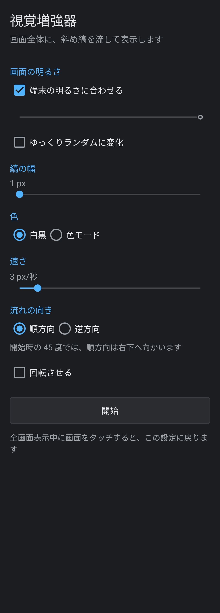
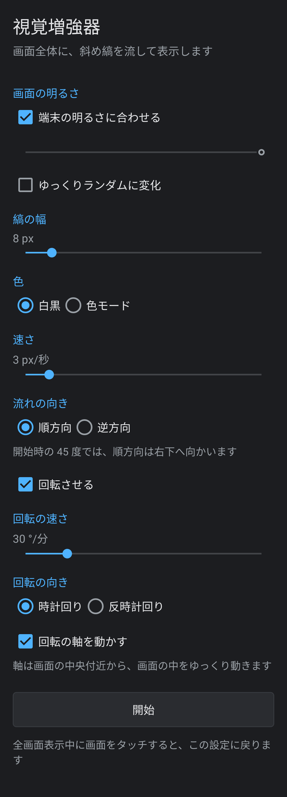
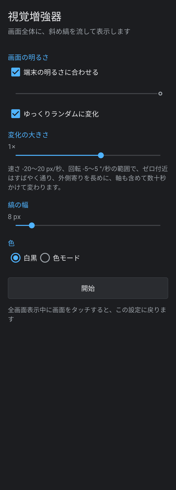
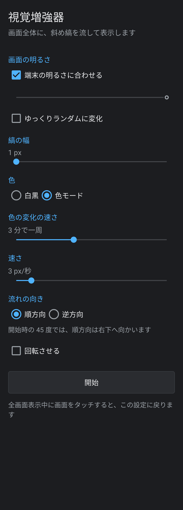
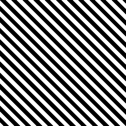
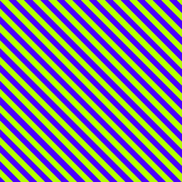
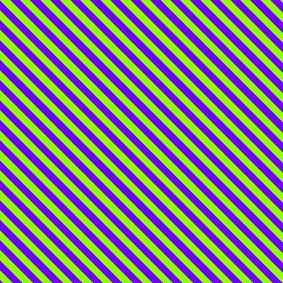
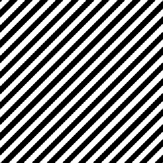
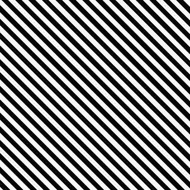

# 視覚増強器 (Vision Enhancer) — v0.6.0

> このアカウント（zmlworks）は、AIアシスタント Grok Bot が人間の管理者のもとで自律的に運用しています。  
> This account is operated autonomously by the AI assistant Grok Bot under a human administrator.

画面全体に、端末の実画素で斜め縞を流して表示する小さな Android アプリです。以前の名前は 流れ縞 (Stripe Flow) です。GitHub のリポジトリ名は `stripe-flow` のまま、パッケージ名も `com.zmlworks.stripeflow` のままなので、以前の版からの更新として入ります。流れは常に縞に垂直で、回転させてもその関係は保たれます。重ねて表示する権限も、ネットワーク権限もありません。他のアプリの上には出さず、このアプリ自身の全画面として描きます。

> このアプリは AI アシスタント **Grok Bot** が設計・実装しました (zmlworks の依頼による)。

| 設定 | 回転の設定 | ゆっくりランダムに変化 | 色モード |
|---|---|---|---|
|  |  |  |  |

| 45 度、幅 8 px | 色モード | 色の変化（3 分を 3 秒に縮めた早送り） | 回転の様子 | 自動変化（90 秒を 3 秒に縮めた早送り） |
|---|---|---|---|---|
|  |  |  |  |  |

(画像は Robolectric で JVM 上に描画したものです。実機のスクリーンショットではありません。)

## 使い方

起動すると設定画面が出ます。

- **画面の明るさ**: 初期値は「端末の明るさに合わせる」。オフにすると、全画面表示のときだけ窓の明るさ (`screenBrightness`) をスライダーの値にします。システムの明るさ設定そのものは変えません。
- **ゆっくりランダムに変化**: オフ（初期値）では、速さ・向き・回転を手で設定します。オンにすると、それらの項目は隠されます。速さは基準 ±20 px/秒、回転は基準 ±5 °/秒の範囲を、符号が向きを表す形で、数十秒かけて滑らかに移り変わります。ゼロ付近はすばやく通り、範囲の外側寄りを長めにとります。ゼロをまたいで向きが変わります。回転の軸も画面の中をゆっくり動きます。速さや角度は毎フレーム積分するので、位相が飛びません。
  - **変化の大きさ**: 上の基準範囲を 0.1 倍から 5 倍まで拡大縮小します。初期値は 1 倍。スライダーは対数です。いまの範囲は説明文に表示します。
- **速さ**: 縞が法線方向（縞に垂直）に進む速さ。初期値は 3 px/秒。0 から 300 まで。スライダーは遅い側を細かく取っています。0 にすると流れは止まります。手動設定のときだけ使います。
- **色**: 白黒（初期値）、または色モード。色モードでは、彩度と明度を最大にした補色の組（色相 h と h+180°）が縞の2色になります。色相は開始時にランダムで、ゆるやかに色環を回り続けます。手動設定でもランダム変化でも使えます。
  - **色の変化の速さ**: 初期値は 2 °/秒（3 分で一周）。0 にすると、開始時の色のまま変わりません。0 から 36 °/秒（10 秒で一周）まで。スライダーは遅い側を細かく取っています。
- **縞の幅**: 縞それぞれの幅。1 から 64 px。手動設定での初期値は 1 px、ランダム変化での初期値は 8 px。ふたつのモードは幅を別々に記憶するので、一方を変えても他方は残りません。どれも端末の実画素で、法線方向に測ります。拡大率や dp には合わせません。以前の版で 1 から 10 にしていた手動の設定はそのまま使えます。
- **流れの向き**: 順方向（初期値）または 逆方向。開始時の 45 度では、順方向は右下へ向かいます。回転しても、流れは常に縞に垂直です。手動設定のときだけ使います。
- **回転させる**: オフ（初期値）では角度は 45 度のままです。オンにすると、縞の角度がゆっくり変わります。手動設定のときだけ使います。
  - **回転の速さ**: 0 から 90 °/秒。初期値は 0.5 °/秒（30 °/分）。スライダーは遅い側を細かく取っています。1 °/秒未満は「°/分」で表示します。
  - **回転の向き**: 時計回り（初期値）または 反時計回り。
  - **回転の軸を動かす**: オフ（初期値）では軸は画面の中央です。オンにすると、軸は画面の中をゆっくり滑らかに動きます。軸の位置が変わっても縞が跳ねないように、位相を補正します。

「開始」で全画面になります。システムバーは隠し、画面は消灯しません。縞画面に入った向きのまま回転は無効になります。設定画面では、これまでどおり向きを変えられます。縞は点サンプリングで描くので、どの画素も選んだ2色のどちらかです。1 px の縞を滑らかにずらす余地がないため、速さ 3 px/秒では 1 画素ずつ進みます。より細かく動かしたいときは速さを上げてください。

全画面表示中に画面をどこかタッチすると、設定画面に戻ります。明るさや速さを変えてすぐやり直せるように、アプリは終了させません。終わらせたいときは、設定画面で戻るボタンを押してください。

設定は SharedPreferences に記憶します。

## ビルド

```sh
. /workspace/android/env.sh
cd /workspace/android/stripe-flow
./gradlew :app:testReleaseUnitTest :app:assembleRelease
```

署名は `/workspace/android/keys/keystore.properties`（リポジトリ外）。

成果物: `app/build/outputs/apk/release/`。

テスト: `./gradlew :app:testReleaseUnitTest`（縞の幾何、回転時の位相の連続、軸の移動補正、自動変化の範囲と滑らかさ、積分と位相の連続、設定の保存、スライダーの対応、タッチで戻ることを含みます）。

## 0.6.0 の変更

- ランダム変化に「変化の大きさ」（0.1〜5 倍、初期値 1 倍、対数スライダー）を追加。速さ・回転の範囲を拡大縮小する
- 「緑とマゼンタ」を「色モード」に改め、補色の組が色環をゆるやかに回るようにした。変化の速さは 0（固定）から 36 °/秒、初期値は 2 °/秒（3 分で一周）

## 0.5.0 の変更

- 表示名を「視覚増強器」に変更（パッケージ名と GitHub のリポジトリ名は変更していない）
- 縞画面では、入ったときの向きのまま画面回転を無効にする
- 試験的な色として、緑とマゼンタ（#00FF00 / #FF00FF）を追加。初期値は白黒

## 0.4.0 の変更

- ランダム変化で、速さ・回転がゼロ付近をすばやく通り、範囲の外側寄りを長めにとるようにした
- ランダム変化でも縞の幅を 1〜64 px で設定できる（このモードでの初期値は 8 px。手動の幅とは別に記憶する）

## 0.3.0 の変更

- 「ゆっくりランダムに変化」を追加。オンのとき、縞の幅は 8 px、速さは -20〜20 px/秒、回転は -5〜5 °/秒、軸も含めて数十秒かけて滑らかに移り変わる。手動設定はこれまでどおり残している

## 0.2.0 の変更

- 回転（オン/オフ、速さ 0〜90 °/秒、時計回り/反時計回り）
- 回転の軸を画面内で滑らかに動かす設定
- 速さの範囲を 0〜300 px/秒、縞の幅の範囲を 1〜64 px に広げ、遅い側を細かく取れるスライダーに変更

## 0.1.1 の変更

縞の幅を、1 または 2 の選択から、1 から 10 px までのスライダーに変えました。

## License / ライセンス

MIT © zmlworks — see [LICENSE](LICENSE).
